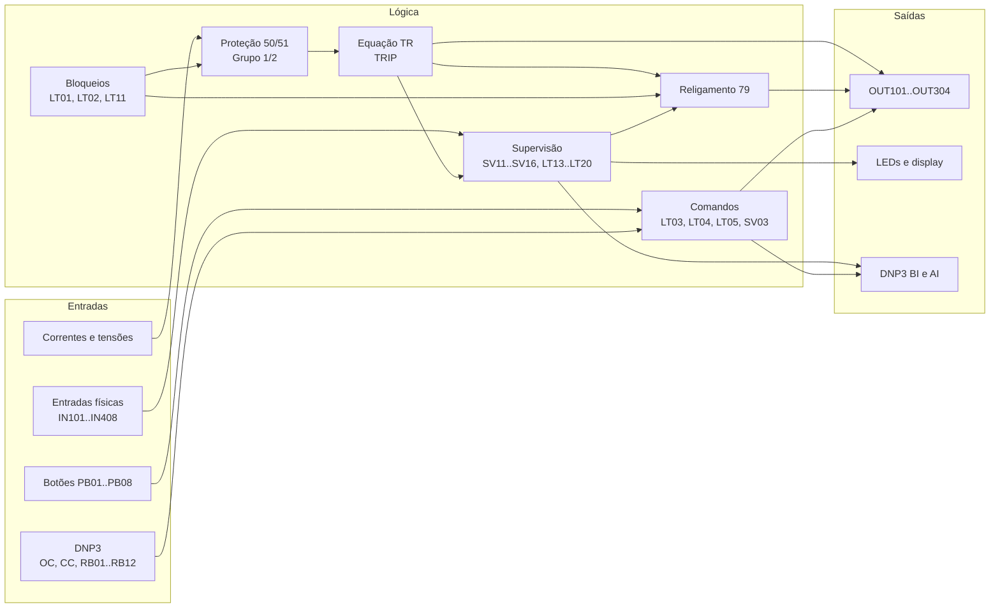
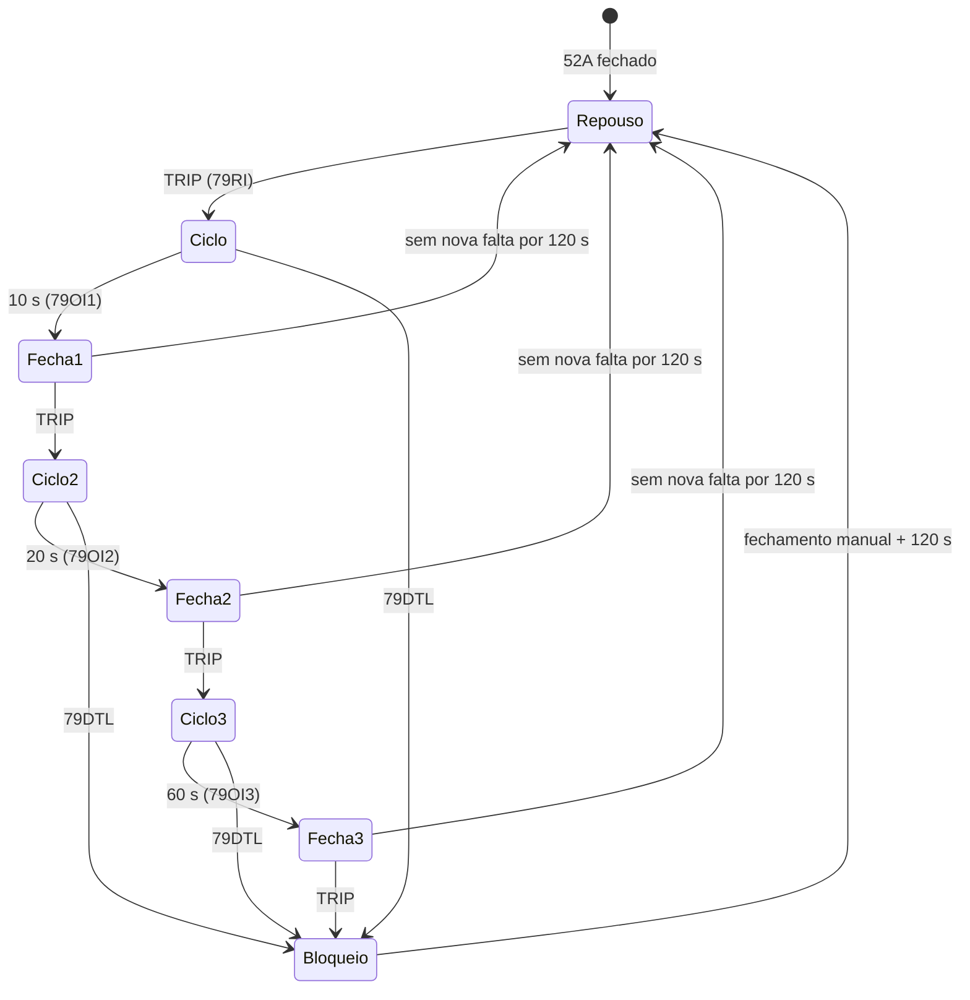

# Roadmap da lógica – SEL-751 "Alimentador v1.24"

| Item | Valor |
|---|---|
| Modelo | SEL-751 – Proteção de alimentador |
| Padrão | `SEL751 - Alimentador v1.24` |
| Firmware (FID) | `SEL-751-R...-Z009005` |
| Código de pedido | `751101A1A3A7A850830` |
| Salvo com | AcSELerator QuickSet 7.4.2.0, em 14/03/2025 |
| Origem | `Padrões SEL-751.rdb` → pasta `Relays/SEL751 - Alimentador v1.24` |

> **Escopo.** Este documento explica a lógica de proteção, controle, sinalização e o mapa DNP3.
> O documento não explica Modbus, Mirrored Bits, EtherNet/IP, IEC 60870-5-103 e ajustes de portas.

---

## 0. Convenções de escrita

Este documento aplica as regras principais da norma **ASD-STE100 (Simplified Technical English)**, adaptadas ao português:

- Uma ideia por frase. Frases curtas (máx. ~20 palavras em instruções, ~25 em descrições).
- Voz ativa e tempo presente.
- Um termo para um conceito. Os termos estão no [Glossário](#13-glossário).
- Instruções no modo imperativo, com uma ação por passo.
- Avisos (**ATENÇÃO** / **NOTA**) antes da informação a que se aplicam.

Notação SELogic usada:

| Símbolo | Significado |
|---|---|
| `AND`, `OR`, `NOT` | Operações lógicas. `AND` tem prioridade sobre `OR`. |
| `R_TRIG x` | Borda de subida de `x` (pulso de 1 ciclo de processamento). |
| `F_TRIG x` | Borda de descida de `x`. Para um botão, é o momento em que o operador **solta** o botão. |
| `SVnn` / `SVnnT` | Entrada / saída do temporizador `SVnn`. |
| `PU` / `DO` | Tempo de *pickup* (atraso para ligar) / *dropout* (atraso para desligar), em segundos. |
| `LTnn` | Latch (memória). `SETnn` liga, `RSTnn` desliga. |

---

## 1. Arquivos analisados

| Arquivo | Classe | Uso neste documento |
|---|---|---|
| `set_1.txt` … `set_4.txt` | Grupos de ajuste 1 a 4 | Funções de proteção, disparo, religamento, fechamento. **Os 4 arquivos são idênticos.** |
| `set_L1.txt` … `set_L4.txt` | Lógica 1 a 4 | Latches, temporizadores, contador, variáveis matemáticas, saídas. **Os 4 arquivos são idênticos.** |
| `set_G.txt` | Global | Troca de grupo, tensão CC, filtros das entradas, relógio. |
| `set_F.txt` | Painel frontal | LEDs, botões e mensagens do display. |
| `set_R.txt` | Relatórios | Oscilografia (ER) e registro de eventos (SER). |
| `set_D1.txt` … `set_D3.txt` | Mapas DNP3 | Pontos DNP3. **Os 3 arquivos são idênticos.** As 5 sessões DNP3 usam o mapa 1. |

Arquivos ignorados por escopo: `set_M` (Modbus), `set_E1..E3` (EtherNet/IP), `set_I` (IEC 103), `set_P1..P4` e `set_PF` (portas), `SET_HMI.TXT` (tela touchscreen).

---

## 2. Visão geral

O padrão faz cinco tarefas principais:

1. **Proteção de sobrecorrente** de fase, neutro, terra e sequência negativa (funções 50/51).
2. **Religamento automático** com até 3 tentativas (função 79).
3. **Comando do disjuntor** em modo local (painel) ou remoto (DNP3), com duas bobinas de abertura e duas de fechamento.
4. **Supervisão do disjuntor**: tempo de abertura, falha de disjuntor, mola, motor, bobinas, tensão CC.
5. **Sinalização** para o painel frontal, para o SER e para o sistema supervisório via DNP3.



---

## 3. Entradas e saídas físicas

### 3.1 Entradas digitais

O significado das entradas vem dos comentários, dos *aliases* do SER e das mensagens do display.

| Entrada | Função | Estado normal | Filtro (debounce) |
|---|---|---|---|
| `IN101` | Estado do disjuntor (`52A`) | 1 = fechado | 10 ms |
| `IN102` | Não identificada (só vai para DNP3 `BI_49`) | – | 10 ms |
| `IN301` | Mola carregada | 1 | 10 ms |
| `IN302` | Supervisão da bobina de abertura 1 | 1 = normal, 0 = falha | **10 s** |
| `IN303` | Supervisão da bobina de fechamento 1 | 1 = normal, 0 = falha | **10 s** |
| `IN304` | Gás do disjuntor | 1 = atuado | 10 ms |
| `IN401` | Não identificada (só vai para DNP3 `BI_06`) | – | 10 ms |
| `IN402` | Mecanismo de bloqueio | 1 = atuado | 10 ms |
| `IN403` | Tensão CC do motor da mola | 1 = presente | 10 ms |
| `IN404` | Supervisão da bobina de abertura 2 | 1 = normal, 0 = falha | **10 s** |
| `IN405` | Supervisão da bobina de fechamento 2 | 1 = normal, 0 = falha | **10 s** |
| `IN408` | Motor da mola em funcionamento (dedução pela lógica `SV12`) | 0 | 10 ms |

**NOTA:** O filtro de 10 s nas entradas de supervisão de bobina evita alarmes falsos durante as manobras. Durante uma manobra, o contato de supervisão abre por um tempo curto.

### 3.2 Saídas digitais

| Saída | Equação | Função |
|---|---|---|
| `OUT101` | `TRIP` | Disparo por proteção – bobina de abertura 1. |
| `OUT102` | `SV03T` | Abertura por comando (pulso de 1 s) – bobina de abertura 1. |
| `OUT103` | `CLOSE` | Fechamento manual ou religamento – bobina de fechamento 1. |
| `OUT301` | `CLOSE AND NOT IN303` | Fechamento pela bobina 2. Atua **só** se a bobina de fechamento 1 está em falha. |
| `OUT302` | `LT06` | Watchdog. Fica energizada com o relé normal. |
| `OUT303` | `(TRIP OR SV03T) AND NOT IN302` | Disparo ou abertura pela bobina 2. Atua **só** se a bobina de abertura 1 está em falha. |
| `OUT304` | `LT17` | Relé auxiliar que corta a tensão CC do motor da mola. |

**Comportamento das bobinas redundantes:** a bobina 2 é reserva. O relé usa a bobina 2 só quando a supervisão indica falha na bobina 1.

---

## 4. Funções de proteção (Grupos 1 a 4)

### 4.1 Dados do sistema

| Ajuste | Valor | Significado |
|---|---|---|
| `CTR` / `CTRN` | 120 / 120 | RTC de fase e de neutro (ex.: 600/5 A). |
| `PTR` | 120 | RTP (ex.: 13,8 kV / 115 V). |
| `VNOM` | 115 V | Tensão nominal secundária. |
| `DELTA_Y` | WYE | TPs em estrela. |
| `INOM` | 5 A | Corrente nominal secundária. |
| `52A` | `IN101` | Estado do disjuntor. |
| `52B` | `NOT 52A` | Estado inverso. |

### 4.2 Elementos de sobrecorrente

**ATENÇÃO:** No padrão, **todos os pickups estão em `OFF`**. O padrão define só a estrutura (curvas, controle de torque, equações). Ajuste os pickups conforme o estudo de proteção de cada alimentador.

| Elemento | Tipo | Curva / dial padrão | Controle de torque | No `TR`? |
|---|---|---|---|---|
| `50P1`, `50P2`, `50P3` | Instantâneo de fase, níveis 1–3 | – | Sempre habilitado | Sim |
| `50P4` | Instantâneo de fase, nível 4 | – | Sempre habilitado | **Não** (ver 4.3) |
| `50N1`…`50N3` | Instantâneo de neutro, níveis 1–3 | – | `NOT LT02` | Sim |
| `50N4` | Instantâneo de neutro sensível | – | `NOT LT02` | Sim |
| `50G1`…`50G3` | Instantâneo de terra, níveis 1–3 | – | `NOT LT02` | Sim |
| `50G4` | Instantâneo de terra sensível | – | `NOT LT02` | Sim |
| `50Q1`…`50Q4` | Instantâneo de sequência negativa | – | Sempre habilitado | Não |
| `51P1` | Temporizado de fase | C2 (IEC muito inversa), 0,13 | Sempre habilitado | Sim |
| `51A`, `51B`, `51C` | Temporizado por fase | C2, 0,13 | Sempre habilitado | Não (só indicação) |
| `51P2` | Temporizado de fase 2 | U3 (IEEE muito inversa), 3,00 | Sempre habilitado | Não |
| `51N1` | Temporizado de neutro | C2, 0,37 | `NOT LT02` | Sim |
| `51N2` | Temporizado de neutro 2 | U3, 1,50 | `NOT LT02` | Não |
| `51G1` | Temporizado de terra | U3, 1,50 | `NOT LT02` | Sim |
| `51G2` | Temporizado de terra 2 | U3, 1,50 | `NOT LT02` | Não |
| `51Q` | Temporizado de sequência negativa | U3, 3,00 | Sempre habilitado | Sim |

Funções **desabilitadas** no padrão: direcional (67), subtensão (27), sobretensão (59), frequência (81), potência (32), sincronismo (25), carga fria, HIF, bloqueio por harmônicos, detecção de condutor rompido, falha de disjuntor interna (`52ABF = N`).

### 4.3 Equação de disparo

```
TR = 50P1T OR 50P2T OR 50P3T OR 51P1T
   OR 50N1T OR 50N2T OR 50N3T OR 50N4T OR 51N1T
   OR 50G1T OR 50G2T OR 50G3T OR 50G4T OR 51G1T
   OR 51QT                                      # DISPARO DE PROTECAO
ULTRIP = NOT (qualquer pickup do TR)
TDURD  = 1,0 s
```

Funcionamento:

1. Um elemento da lista atua. O relé ativa `TRIP`.
2. `TRIP` energiza `OUT101` (e `OUT303`, se a bobina de abertura 1 está em falha).
3. `TRIP` fica ativo por no mínimo 1,0 s (`TDURD`).
4. `TRIP` desliga quando nenhum pickup da lista está ativo (`ULTRIP`).

`REMTRIP = 0`: o padrão não tem disparo remoto.

**NOTA:** O elemento `50P4T` não está no `TR`, mas está nas lógicas de tempo de abertura e falha de disjuntor (`SV13`…`SV16`). Se o `50P4` for usado só como detector de corrente, esta é a função dele. Confirme a intenção com o responsável pelo padrão.

### 4.4 Bloqueio de neutro (LT02)

- `LT02 = 1` desabilita **todos** os elementos de neutro e terra (`50N*`, `51N*`, `50G*`, `51G*`).
- O bloqueio age pelo controle de torque (`xxTC = NOT LT02`).
- Os elementos de fase não são afetados.

### 4.5 Indicação da proteção atuada

| Variável | Equação (resumo) | Significado | DO |
|---|---|---|---|
| `SV05` | `51AP AND (50P1T OR 50P2T OR 50P3T) OR 51AT` | Proteção na fase A | 1 s |
| `SV06` | igual, fase B | Proteção na fase B | 1 s |
| `SV07` | igual, fase C | Proteção na fase C | 1 s |
| `SV08` | qualquer `50N/51N/50G/51G` temporizado | Proteção de neutro | 1 s |
| `SV27` | nível 1 atuou sem nível 2 e 3 | Instantâneo nível 1 | 1 s |
| `SV28` | nível 2 atuou sem nível 3 | Instantâneo nível 2 | 1 s |
| `SV29` | nível 3 atuou | Instantâneo nível 3 | 1 s |

A indicação de fase usa os pickups `51AP/51BP/51CP` para identificar a fase em falta. O DO de 1 s garante que o supervisório recebe o pulso.

---

## 5. Religamento automático (79)

### 5.1 Ajustes

| Ajuste | Valor | Função |
|---|---|---|
| `E79` | 3 | Até 3 tentativas de religamento. |
| `79OI1` / `79OI2` / `79OI3` | 10 s / 20 s / 60 s | Tempo morto antes de cada tentativa. |
| `79RSD` | 120 s | Tempo de reset após um religamento com sucesso. |
| `79RSLD` | 120 s | Tempo de reset após o bloqueio (lockout). |
| `79RI` | `TRIP` | Início do ciclo: borda de subida do `TRIP`. |
| `79RIS` | `52A OR 79CY` | Supervisão do início: disjuntor fechado ou ciclo em curso. |
| `79STL` / `79BRS` | `TRIP` | O `TRIP` pausa o tempo morto e o tempo de reset. |
| `79CLSD` | OFF | Sem tempo limite de supervisão de fechamento. |
| `79DTL` | ver 5.2 | Condições de bloqueio (lockout). |

### 5.2 Condições de bloqueio (79DTL)

```
79DTL = SV03T                                   # abertura por comando
     OR SV16T                                   # falha de disjuntor
     OR LT01                                    # religamento bloqueado pelo operador
     OR (50P3T OR 50N3T OR 50G3T OR 50N4T OR 50G4T) AND SH1
     OR (50P2T OR 50N2T OR 50G2T) AND SH2       # BLOQUEIO DE RELIGAMENTO
```

O religamento vai para bloqueio nestes casos:

1. O operador abre o disjuntor por comando.
2. O relé detecta falha de disjuntor.
3. O operador bloqueia o religamento (`LT01 = 1`).
4. O instantâneo nível 3 ou o sensível atua **após o 1º religamento** (`SH1`).
5. O instantâneo nível 2 atua **após o 2º religamento** (`SH2`).

**NOTA:** No 1º disparo (`SH0`), todos os níveis permitem religamento. Esta lógica faz coordenação com os religadores e fusíveis a jusante. Os níveis rápidos saem de serviço nas tentativas seguintes.

### 5.3 Ciclo típico



Estados no painel: LED T04 = repouso (`79RS`), LED T05 = ciclo (`79CY`), LED T06 = bloqueio (`79LO`).

---

## 6. Modos de operação e comandos

### 6.1 Modo Local / Remoto (LT03)

| Estado | `LT03` | Quem comanda |
|---|---|---|
| Local | 1 | Botões do painel frontal. |
| Remoto | 0 | Sistema supervisório (DNP3). |

Para mudar o modo:

- No painel: pressione `PB01`. O botão alterna entre Local e Remoto.
- Por DNP3: envie `RB05` (Local) ou `RB06` (Remoto).

Os LEDs de `PB01` mostram o modo: `PB1A` = Local, `PB1B` = Remoto.

**Regra geral:** os comandos por botão (`PB02`, `PB03`, `PB05`, `PB08`) funcionam só em Local. Os comandos remotos (`RB01`…`RB12`, `CC`) funcionam só em Remoto. As exceções estão em 6.2.

### 6.2 Abertura e fechamento do disjuntor

#### Abertura

```
SET04 = F_TRIG PB04 AND 52A              # AUXILIAR ABRIR (arma o comando)
RST04 = SV01T OR NOT 52A                 # cancela após 5 s ou após abrir
SV03  = OC OR LT04 AND F_TRIG PB04       # COMANDO ABRIR (pulso de 1 s)
```

Procedimento local de abertura:

1. Pressione e solte `PB04`. O relé arma o comando (`LT04`).
2. O LED do `PB04` pisca (oscilador `SV02`, 0,2 s).
3. Pressione e solte `PB04` outra vez em até 5 s. O relé ativa `SV03T`.
4. `SV03T` energiza `OUT102` por 1 s. O disjuntor abre.

**ATENÇÃO:**
- A abertura pelo painel **não exige** modo Local. A abertura local é sempre permitida.
- O comando DNP3 `OC` (BO_00) **não exige** modo Remoto. A abertura remota funciona também em Local.
- A abertura por comando (`SV03T`) leva o religamento para bloqueio.

#### Fechamento

```
SET05 = F_TRIG PB04 AND LT03 AND NOT 52A                # AUXILIAR FECHAR
RST05 = SV01T OR 52A
CL    = CC AND NOT LT03 OR LT03 AND LT05 AND F_TRIG PB04 # COMANDO FECHAR
ULCL  = TRIP
```

Procedimento local de fechamento:

1. Coloque o relé em modo Local.
2. Pressione e solte `PB04`. O relé arma o comando (`LT05`).
3. Pressione e solte `PB04` outra vez em até 5 s. O relé ativa `CLOSE`.
4. `CLOSE` energiza `OUT103` (e `OUT301`, se a bobina de fechamento 1 está em falha).

Regras do fechamento:

- O fechamento remoto (`CC`, BO_01) funciona só em modo Remoto.
- O fechamento local funciona só em modo Local.
- O relé bloqueia o fechamento enquanto `TRIP` está ativo (`ULCL = TRIP`).
- Se o disjuntor não fecha em 0,2 s, o relé indica falha de fechamento (`CFD = 0,2 s`, bit `CF` no SER).

#### Temporização da espera do 2º toque

| Variável | Equação | PU | DO | Função |
|---|---|---|---|---|
| `SV01` | `LT04 OR LT05` | 5 s | 0 | Cancela o comando armado após 5 s. |
| `SV02` | `(LT04 OR LT05) AND NOT SV02T` | 0,2 s | 0,2 s | Oscilador: pisca o LED do `PB04`. |

### 6.3 Comandos de bloqueio e troca de grupo

| Latch | Função | Local (botão, só em Local) | Remoto (DNP3, só em Remoto) | LED |
|---|---|---|---|---|
| `LT01` | Bloqueio do religamento (79) | `PB03` alterna | `RB01` bloqueia / `RB02` desbloqueia | `PB3A` bloqueado / `PB3B` desbloqueado |
| `LT02` | Bloqueio de neutro | `PB02` alterna | `RB03` bloqueia / `RB04` desbloqueia | `PB2A` bloqueado / `PB2B` desbloqueado |
| `LT07` | Grupo de ajuste (0 = G1, 1 = G2) | `PB05` alterna | `RB08` Grupo 2 / `RB07` Grupo 1 | `PB5A` G2 / `PB5B` G1 |
| `LT11` | Bloqueio da seletividade lógica (SL) e da falha de disjuntor (52BF) | `PB08` alterna | `RB11` bloqueia / `RB12` desbloqueia | `PB8A` bloqueado / `PB8B` desbloqueado |

Troca de grupo (Global):

```
SS1 = NOT LT07   # ATIVA O GRUPO 1
SS2 = LT07       # ATIVA O GRUPO 2
TGR = 3 s        # tempo de confirmação da troca
```

**NOTA:** Os grupos 1 a 4 têm ajustes idênticos no padrão. Ajuste o Grupo 2 conforme o estudo. A lógica só usa os grupos 1 e 2.

---

## 7. Supervisão do disjuntor

### 7.1 Tempo de abertura (alarmes em 3 níveis)

O relé mede o tempo entre o `TRIP` e o fim da corrente de falta. A corrente de falta é detectada pelos pickups `51P1P`, `51N1P`, `51G1P` ou pelo `50P4T`.

| Variável | PU | DO | Significado |
|---|---|---|---|
| `SV13` | 0,10 s | 0,5 s | Corrente presente 100 ms após o `TRIP`. |
| `SV14` | 0,12 s | 0,5 s | Corrente presente 120 ms após o `TRIP`. |
| `SV15` | 0,14 s | 0,5 s | Corrente presente 140 ms após o `TRIP`. |
| `SV24` | 0,35 s | 0 | Espera o resultado ficar estável (`SV13T` por 0,35 s). |

| Latch | Condição | Alarme | Reset |
|---|---|---|---|
| `LT18` | `SV13T AND NOT SV14T AND NOT SV15T AND SV24T` | Nível 1: abertura entre 100 e 120 ms | Fechamento do disjuntor |
| `LT19` | `SV13T AND SV14T AND NOT SV15T AND SV24T` | Nível 2: abertura entre 120 e 140 ms | Fechamento do disjuntor |
| `LT20` | `SV13T AND SV14T AND SV15T` | Nível 3: abertura acima de 140 ms | Fechamento do disjuntor |

Exemplo – o disjuntor abre em 110 ms:

1. Em 100 ms, `SV13T` liga.
2. Em 110 ms, a corrente some. `SV14` não chega a ligar.
3. `SV13T` fica ligado por mais 0,5 s (DO).
4. Em 450 ms, `SV24T` liga. A condição do nível 1 é verdadeira.
5. `LT18` liga. O display mostra "TEMPO DE ABERTURA EXCEDIDO NV1".

**NOTA:** O nível 3 não espera o `SV24T`. O alarme é imediato.

### 7.2 Falha de disjuntor (52BF por lógica)

```
SV16 (PU 0,15 s; DO 0,5 s) = TRIP AND (51P1P OR 51N1P OR 51G1P OR 50P4T) AND NOT LT11
SET15 = SV16T          # SINALIZACAO FALHA DJ
RST15 = R_TRIG 52A     # NORMALIZA AO FECHAR DJ
```

1. A corrente de falta continua 150 ms após o `TRIP`.
2. O relé ativa `SV16T` (falha de disjuntor).
3. `SV16T` liga `LT15` (LED T03 "52BF") e leva o religamento para bloqueio.
4. `LT15` desliga quando o disjuntor fecha.

**ATENÇÃO:**
- `LT11 = 1` desabilita a falha de disjuntor.
- Neste padrão, **nenhuma saída física** dispara o disjuntor de retaguarda. O envio do 52BF deve ser feito por GOOSE (configuração IEC 61850, fora do `.rdb`). Confirme na configuração CID.
- A função interna de falha de disjuntor do relé está desabilitada (`52ABF = N`).

### 7.3 Seletividade lógica – envio de bloqueio

| Variável | Equação | Função |
|---|---|---|
| `SV17` | `(50P1P OR 50P2P OR 50P3P OR 51P1P) AND NOT LT11` | Envia bloqueio de partida de fase. |
| `SV18` | `(50N1P OR 50N2P OR 50N3P OR 51N1P OR 50G1P OR 50G2P OR 50G3P OR 51G1P) AND NOT LT11` | Envia bloqueio de partida de neutro. |

O alimentador sente uma falta. O relé envia um sinal de bloqueio ao relé de barra (seletividade lógica). `LT11 = 1` cancela o envio.

**NOTA:** `SV17T` e `SV18T` não vão para saída física nem para DNP3. O envio é por GOOSE (fora do `.rdb`).

### 7.4 Mola e motor

| Variável | Equação | PU / DO | Função |
|---|---|---|---|
| `SV04` | `IN301` | 0 / 30 s | Mola carregada. O alarme de mola descarregada aparece só após 30 s (tempo para o motor recarregar). |
| `SV12` | `IN403 AND IN408` | 30 s / 0 | Motor ligado há mais de 30 s. |
| `LT17` | SET `SV12T`, RST `NOT IN403` | – | Liga `OUT304` e corta a tensão CC do motor. |

1. O motor funciona por mais de 30 s. O fim de curso da mola não atuou.
2. O relé liga `LT17` e `OUT304`. O relé auxiliar corta a tensão do motor.
3. O display mostra "FALHA CH FIM DE CURSO DA MOLA".
4. `LT17` desliga quando a tensão do motor (`IN403`) sai.

### 7.5 Contador de operações

```
SC01CU = F_TRIG 52A   # CONTADOR DE ABERTURAS
SC01PV = 15000
```

O contador soma 1 a cada abertura do disjuntor. O display mostra "NUMERO DE OPERACOES". O limite de 15000 não aciona outra lógica.

---

## 8. Supervisão do relé e da comunicação

| Item | Lógica | Função |
|---|---|---|
| Watchdog | `LT06`: SET `NOT HALARM`, RST `HALARM` → `OUT302` | `OUT302` fica energizada com o relé normal. Desenergiza em falha interna. |
| Tensão CC | `SV11 = NOT (DCLO OR DCHI)`, PU 5 s, DO 0,03 s | `SV11T = 1` com a tensão CC entre 120 V (`DCLOP`) e 140 V (`DCHIP`). |
| Comunicação | `LT13`: SET `LINKA AND LINKB AND (TSNTPP OR TSNTPB)` | `LT13 = 1` com as duas portas Ethernet ativas e o SNTP sincronizado. |
| Saídas | `SV10 = OUT101 OR OUT102 OR OUT103 OR OUT301 OR OUT303`, DO 1 s | Indica que uma saída de comando atuou. |

---

## 9. Sinalização local

### 9.1 LEDs de alvo

| LED | Equação | Significado | Selo (latch) |
|---|---|---|---|
| T01 | `50P1T OR 50P2T OR 50P3T OR 51P1T` | Sobrecorrente de fase | Sim |
| T02 | `50N1T…51G1T` | Sobrecorrente de neutro | Sim |
| T03 | `LT15` | Falha de disjuntor (52BF) | Não |
| T04 | `79RS` | Religamento em repouso | Não |
| T05 | `79CY` | Religamento em ciclo | Não |
| T06 | `79LO` | Religamento em bloqueio | Não |

### 9.2 Botões do painel

| Botão | Função | LED A | LED B |
|---|---|---|---|
| `PB01` | Local / Remoto | Local | Remoto |
| `PB02` | Bloqueio de neutro | Bloqueado | Desbloqueado |
| `PB03` | Bloqueio do 79 | Bloqueado | Desbloqueado |
| `PB04` | Abrir / Fechar (dois toques) | Aberto | Fechado |
| `PB05` | Grupo 1 / Grupo 2 | Grupo 2 | Grupo 1 |
| `PB06`, `PB07` | Sem uso | – | – |
| `PB08` | Bloqueio SL e 52BF | Bloqueado | Desbloqueado |

### 9.3 Mensagens do display (rotativas)

| Ponto | Fonte | Texto exibido |
|---|---|---|
| DP01–DP02 | `RID`, `TID` | Identificação do relé e da subestação |
| DP03–DP06 | `IA`, `IB`, `IC`, `IG` | Correntes de fase e neutro (A) |
| DP07–DP09 | `MV01`…`MV03` | Tensões de linha (kV) |
| DP10 | `SV04T = 0` | MOLA DESCARREGADA |
| DP11 | `IN403 = 0` | FALHA TENSAO CC MOTOR |
| DP12–DP15 | `IN302`…`IN405 = 0` | FALHA BOBINA (abertura/fechamento 1 e 2) |
| DP16 | `IN402 = 1` | MECANISMO DE BLOQUEIO ATUADO |
| DP17 | `OUT304 = 1` | FALHA CH FIM DE CURSO DA MOLA |
| DP18–DP20 | `LT18`…`LT20 = 1` | TEMPO DE ABERTURA EXCEDIDO NV1/NV2/NV3 |
| DP21 | `LT13 = 0` | COMUNICACAO DEGRADADA |
| DP22 | `SV11T = 0` | TENSAO CC FORA DA FAIXA |
| DP23 | `SC01` | NUMERO DE OPERACOES |
| DP32 | – | Versão do padrão: `v1.24` |

### 9.4 Variáveis matemáticas

| Variável | Equação | Uso |
|---|---|---|
| `MV01`…`MV03` | `VAB/VBC/VCA_MAG / 1000` | Tensões em kV para o display. |
| `MV04` | `0.00` (comentário: `RTC * 51P1P`) | Pickup de fase para o DNP3. **Valor fixo em zero.** |
| `MV05` | `0.00` (comentário: `RTC * 51N1P`) | Pickup de neutro para o DNP3. **Valor fixo em zero.** |

---

## 10. Registros

### 10.1 Oscilografia

```
ER  = F_TRIG 52A OR R_TRIG TRIP   # REGISTRO DE OSCILOGRAFIA
LER = 64 ciclos, PRE = 40 ciclos
```

O relé grava uma oscilografia quando o disjuntor abre ou quando o `TRIP` ativa. A equação Global `FAULT` usa os pickups de sobrecorrente para marcar a condição de falta.

### 10.2 SER (registro sequencial de eventos)

As listas `SER1`…`SER4` gravam:

- Pickups e disparos de sobrecorrente, estado do 79.
- `TRIP`, `CLOSE`, `CF`, entradas `IN101`…`IN408`, saídas.
- Latches `LT01`…`LT20`, temporizadores `SV03T`…`SV30T`.
- Botões `PB01`…`PB08`, comandos `OC`, `CC`, `RB01`…`RB12`.
- Contador de tentativas `SH0`…`SH3`.

Os *aliases* dão nome e texto de estado em português para 20 pontos (ex.: `52A` → "DISJUNTOR FECHADO/ABERTO").

---

## 11. Mapa DNP3 (mapa 1)

### 11.1 Saídas binárias (comandos do supervisório)

| Ponto | Bit | Comando | Supervisão |
|---|---|---|---|
| BO_00 | `OC` | Abrir disjuntor | Sem supervisão de modo |
| BO_01 | `CC` | Fechar disjuntor | Só em Remoto |
| BO_02 | `RB01` | Bloquear religamento | Só em Remoto |
| BO_03 | `RB02` | Desbloquear religamento | Só em Remoto |
| BO_04 | `RB03` | Bloquear neutro | Só em Remoto |
| BO_05 | `RB04` | Desbloquear neutro | Só em Remoto |
| BO_06 | `RB05` | Passar para Local | Sem supervisão de modo |
| BO_07 | `RB06` | Passar para Remoto | Sem supervisão de modo |
| BO_08 | `RB07` | Ativar Grupo 1 | Só em Remoto |
| BO_09 | `RB08` | Ativar Grupo 2 | Só em Remoto |
| BO_10 | `RB11` | Bloquear SL e 52BF | Só em Remoto |
| BO_11 | `RB12` | Desbloquear SL e 52BF | Só em Remoto |

### 11.2 Entradas binárias (estados e alarmes)

| Ponto | Bit | Significado |
|---|---|---|
| BI_00 | `LT06` | Relé normal (watchdog) |
| BI_01 | `52A` | Disjuntor fechado |
| BI_02 | `SV04T` | Mola carregada (0 = descarregada há > 30 s) |
| BI_03 | `IN302` | Bobina de abertura 1 normal |
| BI_04 | `IN303` | Bobina de fechamento 1 normal |
| BI_05 | `IN304` | Gás do disjuntor atuado |
| BI_06 | `IN401` | Entrada IN401 (função não identificada) |
| BI_07 | `IN402` | Mecanismo de bloqueio atuado |
| BI_08 | `IN403` | Tensão CC do motor presente |
| BI_09 | `IN404` | Bobina de abertura 2 normal |
| BI_10 | `IN405` | Bobina de fechamento 2 normal |
| BI_11 | `LT02` | Neutro bloqueado |
| BI_12 | `LT03` | Modo Local |
| BI_13 | `LT07` | Grupo 2 ativo |
| BI_14 | `LT11` | SL e 52BF bloqueados |
| BI_15 | `LT12` | **Latch sem lógica** (ver 12) |
| BI_16 | `LT13` | Comunicação normal |
| BI_17 | `79RS` | Religamento em repouso |
| BI_18 | `79CY` | Religamento em ciclo |
| BI_19 | `LT01` | Religamento bloqueado |
| BI_20…BI_22 | `51AP`, `51BP`, `51CP` | Partida de fase A, B, C |
| BI_23 | `51G1P` | Partida de terra |
| BI_24 | `51N1P` | Partida de neutro |
| BI_25 | `51P1T` | Disparo temporizado de fase |
| BI_26 | `51G1T` | Disparo temporizado de terra |
| BI_27 | `51N1T` | Disparo temporizado de neutro |
| BI_28…BI_30 | `SV27T`, `SV28T`, `SV29T` | Disparo instantâneo nível 1, 2, 3 |
| BI_31…BI_33 | `SV05T`, `SV06T`, `SV07T` | Proteção atuada na fase A, B, C |
| BI_34 | `SV08T` | Proteção de neutro atuada |
| BI_35 | `SV10T` | Saída de comando atuou |
| BI_36 | `SV11T` | Tensão CC normal |
| BI_37 | `SV16T` | Falha de disjuntor |
| BI_38 | `SV19T` | **Temporizador sem lógica** (ver 12) |
| BI_39 | `SV26T` | **Temporizador sem lógica** (ver 12) |
| BI_40 | `OUT304` | Corte do motor da mola atuado |
| BI_41…BI_43 | `LT18`, `LT19`, `LT20` | Tempo de abertura excedido NV1, NV2, NV3 |
| BI_44 | `79LO` | Religamento em bloqueio |
| BI_45 | `51QP` | Partida de sequência negativa |
| BI_46 | `51QT` | Disparo de sequência negativa |
| BI_47 | `50G4T` | Disparo de terra sensível |
| BI_48 | `SV25T` | **Temporizador sem lógica** (ver 12) |
| BI_49 | `IN102` | Entrada IN102 (função não identificada) |

### 11.3 Entradas analógicas (medições)

Formato: `grandeza:fator de escala:banda morta`.

| Ponto | Grandeza | Escala | Banda morta |
|---|---|---|---|
| AI_00…AI_03 | `IA`, `IB`, `IC`, `IG` (A) | ×10 | 5 |
| AI_04…AI_06 | `VA`, `VB`, `VC` (kV) | ×0,1 | 10 |
| AI_07…AI_09 | `VAB`, `VBC`, `VCA` (kV) | ×0,1 | 10 |
| AI_10, AI_11 | `P` (MW), `Q` (MVAr) | ×0,01 | 10 |
| AI_12 | `PF` | ×1000 | 5 |
| AI_13 | `MWH3P` | ×100 | 5 |
| AI_14 | `MVARH3PO` | ×10 | 5 |
| AI_15 | `MWH3PI` | ×10 | 5 |
| AI_16 | `MVARH3PI` | ×10 | 5 |
| AI_17…AI_21 | `FIA`, `FIB`, `FIC`, `FIG`, `FIN` | padrão | padrão |
| AI_22, AI_23 | `MV04`, `MV05` (pickups) | padrão | padrão |
| AI_24 | `VDC` | padrão | padrão |
| AI_25 | `FLOC` (localização da falta) | padrão | padrão |
| AI_26 | `3I2` | ×10 | 5 |
| AI_27 | `3V2` | ×1 | 10 |

Contadores (CO) e saídas analógicas (AO): sem pontos mapeados.

---

## 12. Pontos de atenção

Os itens abaixo são inconsistências ou pontos para confirmar. Eles não impedem a operação, mas podem confundir a manutenção.

| # | Item | Observação | Ação recomendada |
|---|---|---|---|
| 1 | Pickups em `OFF` | Todos os elementos de proteção estão desligados no padrão. | Ajuste conforme o estudo de cada alimentador. |
| 2 | `MV04`, `MV05` = 0 | DNP3 AI_22 e AI_23 sempre enviam zero. | Ajuste a equação `RTC * pickup` ou remova os pontos. |
| 3 | `LT12` sem lógica | O SER tem alias "ABERTURA_52BF" e o DNP3 BI_15 usa `LT12`, mas `SET12/RST12 = NA`. | Confirme se o ponto deve ser `LT15`. |
| 4 | `SV19`, `SV20`, `SV21`, `SV25`, `SV26` sem lógica | Estão no SER (aliases "CURTO_BARRA", "BLOQ_FASE_RECEB", "BLOQ_N_RECEB", "COMUNIC_GOOSE") e no DNP3 (BI_38, BI_39, BI_48). | Parecem reservas para a lógica de barra/GOOSE. Complete ou remova. |
| 5 | `50P4T` fora do `TR` | O elemento só alimenta a supervisão de abertura e o 52BF. | Confirme a intenção. |
| 6 | Falha de disjuntor sem saída física | `SV16T` só sinaliza e bloqueia o 79. | Confirme o envio por GOOSE no CID. |
| 7 | `OC` sem supervisão de modo | O supervisório abre o disjuntor também em Local. | Comportamento comum por segurança. Confirme a intenção. |
| 8 | `IN102`, `IN401` sem descrição | Estão no DNP3, mas sem alias nem comentário. | Documente a função. |
| 9 | `TIME_SRC = IRIG1` | Não há IRIG (`IRIGC = NONE`). A lógica `LT13` supervisiona o SNTP. | Confirme a fonte de tempo. |

---

## 13. Glossário

| Termo | Significado |
|---|---|
| 50 | Sobrecorrente instantânea (ou de tempo definido). |
| 51 | Sobrecorrente temporizada (curva inversa). |
| 52A | Contato auxiliar do disjuntor: 1 = fechado. |
| 52BF | Falha de disjuntor (*breaker failure*). |
| 79 | Religamento automático. |
| Bloqueio (lockout) | Estado do 79 em que o relé não religa. |
| Controle de torque (TC) | Equação que habilita ou desabilita um elemento de proteção. |
| GOOSE | Mensagem IEC 61850 entre relés. |
| Latch (LT) | Memória que fica ligada até receber reset. |
| OC / CC | Comando de abertura / fechamento por protocolo. |
| PB | Botão do painel frontal (*pushbutton*). |
| RB | Bit remoto (*remote bit*), comandado por protocolo. |
| SER | Registro sequencial de eventos. |
| SH0…SH3 | Número da tentativa de religamento em curso. |
| SL | Seletividade lógica. |
| SV | Variável SELogic com temporizador. |
| TRIP | Sinal de disparo do relé. |
