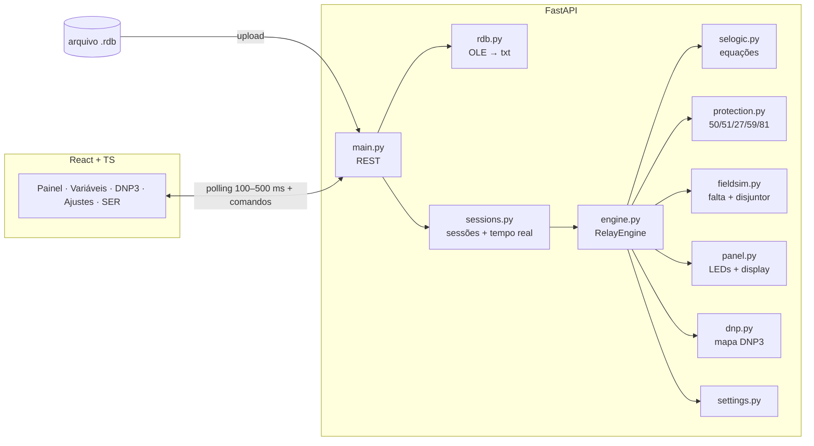

# Arquitetura

## Backend (`backend/app`)

| Módulo | Responsabilidade |
|---|---|
| `rdb.py` | Abre o contêiner OLE (`olefile`), extrai `Relays/<nome>/set_*.txt` e `Misc/*.txt`; gera `.zip` por ajuste. |
| `settings.py` | Parser dos `set_*.txt` (`[INFO]`, `[classe]`, `NOME,"valor"` com aspas escapadas). Acesso por classe (`G`, `1..4`, `L1..L4`, `F`, `R`, `D1..D3`). |
| `selogic.py` | Interpretador SELogic (NOT/AND/OR/XOR, R_TRIG/F_TRIG, comparações, aritmética, comentários `#`). |
| `curves.py` | Curvas U1–U5 (IEEE) e C1–C5 (IEC). |
| `protection.py` | Elementos 50/51 (fase, neutro, terra, seq. negativa), 27/59 (tensão) e 81D (frequência), criados a partir do grupo ativo. |
| `fieldsim.py` | "Campo": fasores de corrente/tensão, tipos de falta, afundamento de tensão, modelo de disjuntor (tempos de abertura/fechamento). |
| `engine.py` | `RelayEngine`: ciclo de varredura, TRIP/CLOSE, religamento 79, lógica do usuário (SV, SC, MV, LT, OUT), grupos de ajuste, SER, snapshots. |
| `panel.py` | LEDs de alvo (com retenção), LEDs dos botões, pontos de display (DP). |
| `dnp.py` | Mapa DNP3: BO/BI/AI, banda morta, eventos, comandos Select/Operate/Direct. |
| `describe.py` | Rótulos legíveis (comentários, ALIAS do SER, textos de display). |
| `sessions.py` | Sessões e o laço de tempo real (varredura a cada 10 ms; velocidade 0,5×–10×). |
| `main.py` | API REST e entrega do frontend compilado. |

### Ciclo de varredura (`RelayEngine.step(dt)`)

1. Consome **um** evento da fila (botão pressionado/solto, pulso de bit remoto/OC/CC, target reset). Um evento por ciclo
   garante que `pressionar → soltar` gere bordas distintas para `R_TRIG`/`F_TRIG`.
2. Entradas digitais com *debounce* (ajustes `INxxxD`) e grandezas analógicas (fasores → valores secundários/primários).
3. Elementos de proteção.
4. `TR → TRIP` (retenção, `TDURD`, `ULTRIP`), religamento 79, `CL → CLOSE` (`CFD`, `ULCL`).
5. Lógica do usuário, **nesta ordem**: variáveis SV → contadores → variáveis matemáticas → latches → saídas OUT.
6. Disjuntor: bobinas (saídas de abertura/fechamento) → posição → entrada 52A (no ciclo seguinte).
7. Seleção de grupo de ajustes (`SS1..SS4`, atraso `TGR`), LEDs, SER e DNP3.

Cada equação é avaliada exatamente uma vez por ciclo (sem curto-circuito), para que os detectores de borda funcionem.

## Frontend (`frontend/src`)

| Arquivo | Conteúdo |
|---|---|
| `App.tsx` | Fluxo: upload → seleção do ajuste → simulador; restaura a sessão ao recarregar (localStorage). |
| `components/RelayFront.tsx`, `Lcd.tsx` | Frontal do relé; lógica do display (rotação dos pontos, menu MEDIÇÃO/ALVOS/STATUS) e dos botões. |
| `components/TestBench.tsx` | Tela inicial da simulação: disjuntor (campo), medição, entradas digitais (com IN101 auto/manual), saídas digitais, auxiliares. |
| `components/MeasurementCard.tsx` | Medição: módulo/ângulo primário e secundário, frequência, P/Q/S/FP. |
| `components/InjectionWindow.tsx`, `PhasorDiagram.tsx`, `phasor.ts` | Janela de injeção (pop-up em `#/injecao/<sessão>`): módulo/ângulo, primário/secundário, diagrama fasorial, componentes de sequência, falta. |
| `components/VariablesView.tsx` | Estado interno completo, com filtro e "só ativos". |
| `components/DnpView.tsx` | Comandos BO, BI, AI e eventos. |
| `components/SettingsView.tsx` | Consulta/edição dos ajustes e texto original. |
| `components/EventsView.tsx` | SER. |
| `api.ts`, `hooks.ts`, `types.ts` | Cliente REST (com fila ordenada para eventos de botão), `usePoll`, tipos. |

O estado do relé é obtido por **polling** (`/panel` a 10 Hz; `/state`, `/dnp`, `/ser` a 2–2,5 Hz quando a aba está aberta).
Os eventos de botão vão por `POST` em ordem (fila no cliente).
