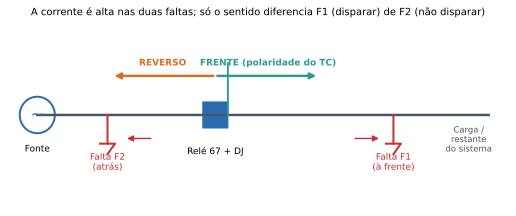
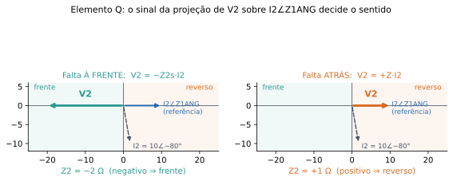
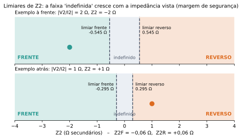
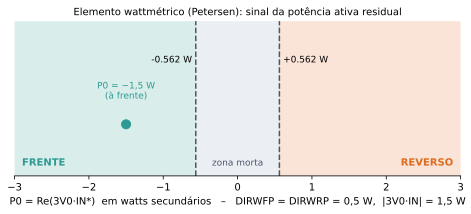
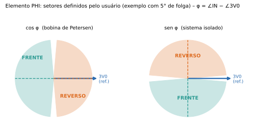
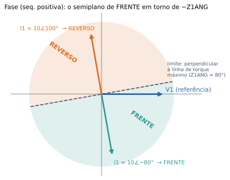
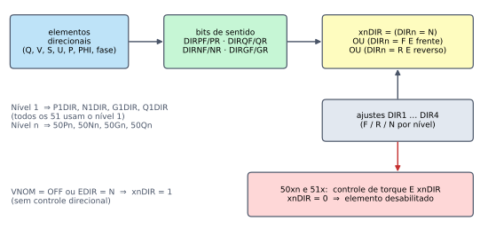
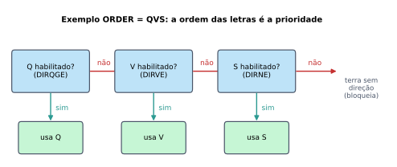
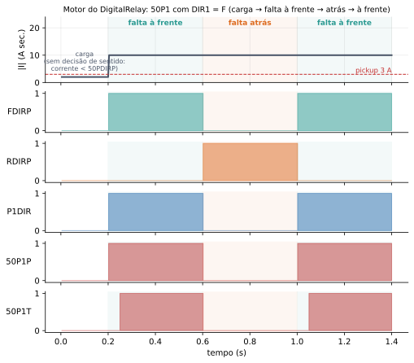

# Função direcional (67) – guia didático

Este guia explica como o SEL-751 decide **para qual lado** está uma falta e como essa decisão "liga" ou "desliga" os elementos de sobrecorrente 50 e 51.
Leia antes, se precisar, [`funcoes-50-51.md`](funcoes-50-51.md). A implementação do DigitalRelay está em `backend/app/directional.py`
(resumo técnico em [`logica-simulada.md`](logica-simulada.md#controle-direcional-67)).

---

## 1. Por que precisamos saber o sentido?

A sobrecorrente 50/51 só enxerga **quanto** de corrente passa, não **de onde** ela vem. Isso basta num alimentador radial (a falta só pode estar à frente), mas falha quando a corrente pode circular nos dois sentidos:

```
 fonte A ──[Relé 1]────────[Relé 2]── fonte B          linha com fontes nos dois lados
 ramais paralelos / anéis / geração distribuída / transformadores em paralelo
```

Uma falta **atrás** do relé também produz corrente alta nele. Sem direção, o relé atuaria indevidamente e desligaria um circuito sadio. A função 67 é, na prática, uma **chave** que diz:
"só vale esta corrente se a falta estiver à frente (ou só se estiver atrás)".



*Figura 1 – A corrente de falta é alta tanto em F1 (à frente) quanto em F2 (atrás); o relé direcional só deve disparar para F1.*

> **67 = 50/51 + direção.** O relé não troca o elemento de sobrecorrente: ele apenas o **habilita** quando o sentido da falta é o desejado.

---

## 2. Conceitos fundamentais

### 2.1 Frente e reverso

- **Frente (forward):** o sentido para onde apontam os TCs (por convenção do SEL-751, para a **linha protegida**, saindo do barramento).
- **Reverso (reverse):** o sentido oposto (para o barramento/fonte).

A direção é sempre **relativa à polaridade dos TCs**. Se o TC for ligado ao contrário, "frente" e "reverso" trocam.

### 2.2 Grandeza de polarização

Para saber o sentido de uma corrente é preciso compará-la com uma **referência de fase** que não muda com o sentido da falta. Essa referência é a **grandeza de polarização**, quase sempre uma tensão:

| Polarização | Quando é boa |
|---|---|
| Tensão de **sequência negativa** (V2) | Faltas **desequilibradas** (fase-terra, fase-fase). Existe em qualquer falta assimétrica. |
| Tensão de **sequência zero** (V0 ou 3V0) | Faltas **à terra**. Só existe se houver contato com a terra. |
| Tensão de **sequência positiva** (V1, com memória) | Faltas **trifásicas** (equilibradas), quando não há V2 nem V0. |
| **Corrente** de neutro (IN) | Quando há uma corrente de referência independente (ex.: neutro de transformador). *Não disponível no simulador.* |

### 2.3 O ângulo da impedância

Numa falta à frente, a tensão vista pelo relé "cai" sobre a impedância da **fonte atrás** do relé; numa falta atrás, a tensão sobe sobre a impedância da **linha à frente**. Em termos de sinais:

- **Falta à frente:** `V2 = −Z2s · I2` e `V0 = −Z0s · I0` → a impedância "vista" `V/I` é **negativa**.
- **Falta atrás:** `V2 = +Z2l · I2` e `V0 = +Z0l · I0` → a impedância "vista" é **positiva**.

O relé calcula essa impedância projetada no ângulo da linha e compara o **sinal** (e a magnitude) com limiares. É o coração dos elementos Q e V.

### 2.4 Componentes simétricas (revisão rápida)

Qualquer conjunto de fasores trifásicos se decompõe em três conjuntos equilibrados:

```
I0 = (Ia + Ib + Ic) / 3              seq. zero      (3I0 = Ia + Ib + Ic = corrente residual IG)
I1 = (Ia + a·Ib + a²·Ic) / 3         seq. positiva  (a = 1∠120°)
I2 = (Ia + a²·Ib + a·Ic) / 3         seq. negativa
```

| Tipo de falta | I0 | I1 | I2 |
|---|---|---|---|
| Trifásica | 0 | ≠ 0 | 0 |
| Fase-fase | 0 | ≠ 0 | ≠ 0 |
| Fase-terra | ≠ 0 | ≠ 0 | ≠ 0 |
| Carga equilibrada | 0 | ≠ 0 | 0 |

Por isso: **V (seq. zero) e Q (seq. negativa)** resolvem faltas à terra; **Q** também as fase-fase; **seq. positiva** fica com as trifásicas.

---

## 3. Os elementos direcionais do SEL-751

### 3.1 Q – sequência negativa

Usa `V2` e `I2`. Calcula a **impedância de sequência negativa**:

```
Z2 = Re[ V2 · (I2 ∠ Z1ANG)* ] / |I2|²          (Ω secundários)
```

(`*` = conjugado; `Z1ANG` = ângulo da impedância de sequência positiva da linha, parâmetro do relé.)

Limiares (os ajustes são `Z2F`, no sentido frente, e `Z2R`, no reverso):

```
frente   se  Z2 < 0,75·Z2F − 0,25·|V2/I2|        (se Z2F ≤ 0;  se Z2F > 0 usa 1,25·Z2F − …)
reverso  se  Z2 > 0,75·Z2R + 0,25·|V2/I2|        (se Z2R ≥ 0;  se Z2R < 0 usa 1,25·Z2R + …)
```

O termo `0,25·|V2/I2|` é uma "margem de segurança" que cresce com a impedância, afastando decisões duvidosas perto de zero.

**Habilitação** (`DIRQE`): precisa haver corrente de sequência negativa suficiente e coerente:

- `|3I2| ≥ 50QFP` (frente) ou `≥ 50QRP` (reverso) — acima do desequilíbrio normal da carga;
- `|I2| > a2·|I1|` — evita decisões com desequilíbrio "de carga" (a2 padrão = 0,10);
- sem perda de potencial e com `VNOM` diferente de `OFF`.

Para o elemento de **terra** há ainda `DIRQGE`: `|I2| > k2·|I0|` (k2 padrão = 0,2), garantindo que a seq. negativa seja um sinal forte frente à seq. zero.

#### Exemplo numérico (falta fase-terra A)

Seja `I2 = 10∠−80°` A, `Z1ANG = 80°`, `Z2F = −0,06 Ω`, `Z2R = +0,06 Ω`.

- **À frente**, com fonte atrás de `Z2s = 2∠80° Ω`: `V2 = −Z2s·I2 = −20∠0° = 20∠180°` V.
  `I2∠Z1ANG = 10∠0°`, então `Z2 = Re[20∠180° · 10∠0°] / 100 = −2 Ω`.
  Limiar de frente: `0,75·(−0,06) − 0,25·(20/10) = −0,545 Ω`. Como `−2 < −0,545` ⇒ **FRENTE**.
- **Atrás**, com linha de `1∠80° Ω`: `V2 = +10∠0°` V ⇒ `Z2 = +1 Ω`.
  Limiar de reverso: `0,75·0,06 + 0,25·1 = 0,295 Ω`. `1 > 0,295` ⇒ **REVERSO**.



*Figura 2 – Girando I2 pelo ângulo da linha (Z1ANG) ele vira o eixo de referência: se V2 aponta para o lado oposto, Z2 é negativa (frente); se aponta para o mesmo lado, positiva (reverso).*



*Figura 3 – Z2 comparada com os limiares: a faixa "indefinida" no meio cresce com a impedância vista, dando margem de segurança.*

### 3.2 V – sequência zero (tensão)

Mesma lógica do Q, mas com `3V0` (soma VA+VB+VC) e `IG = 3I0`:

```
Z0 = Re[ 3V0 · (IG ∠ Z0MTA)* ] / |IG|²
```

- `Z0MTA`: ângulo de torque máximo (≈ ângulo da linha de sequência zero).
- Limiares com `Z0F`/`Z0R`, idênticos aos de Z2.
- Habilitação (`DIRVE`): `|IG| ≥ 50GFP / 50GRP`, `|I0| > a0·|I1|` (a0 = 0,10), `EDIRIV` verdadeiro e sem perda de potencial.

Em sistemas **solidamente aterrados** costuma-se usar `Q` e/ou `V`.

### 3.3 S, U e P – sistemas aterrados por impedância, isolados e com bobina de Petersen

Nesses sistemas a corrente de falta à terra é **muito pequena** (às vezes < 1 A) e é medida por um TC de núcleo (canal **IN**, 0,2 A nominal):

| Elemento | Sistema | Como decide |
|---|---|---|
| **S** | Aterrado por baixa impedância | Como o V, mas com a corrente do canal IN: `Z0 = Re[3V0·(IN∠Z0MTA)*]/|IN|²`. |
| **U** | Isolado / alta impedância | Ângulo **fixo de −90°** (corrente capacitiva): `Z0 = Re[3V0·(IN∠−90°)*]/|IN|²`, `Z0F = −0,10`, `Z0R = +0,10`. |
| **P** | Bobina de Petersen (compensado) | **Wattmétrico**: usa a **potência ativa** residual `P0 = Re(3V0·IN*)`. À frente se `P0` for suficientemente negativa; no reverso, positiva. |

O wattmétrico só atua com `|3V0| > 59RES`, `|IN| > 0,005 A` e depois do atraso `DIRWD`; fica bloqueado por 30 ciclos após manobra do disjuntor (52A).



*Figura 4 – A potência ativa residual P0 negativa indica falta à frente; positiva, reverso; a zona morta evita decisões com sinal fraco.*

### 3.4 PHI – setores configuráveis

O elemento **PHI** (dois níveis, `EPHI1/EPHI2`) mede o ângulo `φ = ∠IN − ∠3V0` e compara com **setores** definidos pelo usuário (`FWD1ANG…FWD2ANG` para frente; `REV1ANG…REV2ANG` para reverso), com linhas de torque máximo (`FWDMTA`, `REVMTA`) e magnitude mínima (`PHIFWDP`, `PHIREVP`). Com os ajustes certos reproduz os clássicos **cos φ** (Petersen) e **sen φ** (isolado).



*Figura 5 – Setores de frente e reverso do PHI em relação a 3V0, para as configurações clássicas cos φ e sen φ (com 5° de folga).*

### 3.5 Fase – sequência positiva com memória

Para faltas **trifásicas** (sem V2/V0), usa `V1` e `I1`:

```
FRENTE  se  Re[ V1 · (I1 ∠ Z1ANG)* ] > 0        REVERSO se < 0
```

Equivale a dizer que o ângulo de `V1/I1` está a menos de ±90° do ângulo da linha (`Z1ANG`).
Detalhes importantes:

- A tensão cai muito numa falta trifásica próxima; por isso usa-se uma **memória** da tensão pré-falta (no simulador, 0,1 s).
- `50PDIRP`: as três correntes de linha precisam passar de um mínimo (`√3 × 50PDIRP`), senão a decisão é ignorada.
- O elemento de **sequência negativa tem prioridade** sobre o de sequência positiva (faltas assimétricas usam Q).
- **Load-encroachment (`ELOAD`):** se `Z1 = V1/I1` cai na região de carga (ângulo próximo de zero e |Z| grande), o elemento é bloqueado — carga pesada não pode parecer falta.



*Figura 6 – Com V1 como referência, o semiplano de frente é centrado em −Z1ANG; correntes do outro lado do limite perpendicular são reversas.*

### 3.6 Elementos que não estão no simulador

Canal **IN polarizado por corrente (I)**, **condutância incremental** (Petersen, alarme) e **falta intermitente direcional (IGF)** não são simulados (veja [limitações](#9-limitações-do-simulador)).

---

## 4. Como a direção chega aos elementos 50/51

```
V e I ─▶ elementos direcionais (Q, V, S, U, P, PHI, fase) ─▶ bits de sentido
                                                              │
  DIRPF / DIRPR   fase                                        ▼
  DIRQF / DIRQR   sequência negativa            ajuste do nível DIR1…DIR4
  DIRNF / DIRNR   neutro                        (F = frente, R = reverso, N = não direcional)
  DIRGF / DIRGR   residual (terra)                            │
                                                              ▼
                                           P1DIR … P4DIR, N1DIR…, G1DIR…, Q1DIR…
                                                              │  (1 = libera, 0 = bloqueia)
                                                              ▼
                                           elementos 50xn e 51x  ──▶ TR ──▶ TRIP
```

Para cada nível **n** (1 a 4) e cada tipo de elemento, o bit de controle é:

```
xnDIR = (DIRn = N)  OU  (DIRn = F E sentido à frente)  OU  (DIRn = R E sentido reverso)
```

- Nível **bloqueado** (`xnDIR = 0`): o elemento se comporta como se o controle de torque fosse falso (pickup cai, disco do 51 rearma).
- **Todos os 51** são controlados pelo nível **1** (`DIR1`); os 50 seguem o seu próprio nível (`50P2` → `DIR2`, etc.).
- Quando o elemento direcional não decide (corrente muito pequena, sem polarização), `DIRxF` e `DIRxR` ficam **ambos em 0**: níveis `F` ou `R` **bloqueiam**; só `N` passa.
- No relé, as versões controladas por sentido dos 50 chamam-se `67xnP/T`. No DigitalRelay elas **espelham** os bits `50xnP/T`.



*Figura 7 – Como o sentido calculado vira o bit xnDIR que libera ou bloqueia cada nível dos elementos 50 e 51.*

---

## 5. Ajustes principais

| Ajuste | Para que serve |
|---|---|
| **`EDIR`** | `N` desliga a direção (tudo não direcional). `Y` usa os ajustes do usuário. `AUTO` / `AUTO2` calculam automaticamente limiares (Z2F, Z2R, 50QFP, 50QRP, a2, k2, 50GFP, 50GRP, Z0F, Z0R, a0, Z0MTA) a partir dos dados da linha (`Z1MAG`, `Z0MAG`, `Z0ANG`) e do TC nominal. |
| **`DIR1…DIR4`** | `F`, `R` ou `N` para cada **nível** de sobrecorrente. |
| **`ORDER`** | Quais elementos de **terra** usar e em que **prioridade** (letras `Q V I S P U`, ou `OFF`). |
| **`EFWDLOP`** | Se `Y`, na **perda de potencial** os elementos ajustados para frente passam a funcionar como não direcionais. |
| **`VNOM = OFF`** | Sem tensões ligadas: fase e seq. negativa ficam não direcionais. |
| **`Z1ANG`, `Z0ANG`, `Z1MAG`, `Z0MAG`** | Dados da linha (ângulos e módulos de impedância). |
| **`EDIRIV`** | Equação SELogic que habilita V/I (normalmente `1`; desabilite com contato do disjuntor para evitar acoplamento de seq. zero). |

### 5.1 `EDIR = AUTO` e `AUTO2`

- **AUTO:** pensado para **linhas**. `Z2F = 0,5·Z1MAG`, `Z2R = Z2F + 1/INOM`, `Z0F = 0,5·Z0MAG`, `Z0R = Z0F + 1/INOM`, `50QFP = 0,1·INOM`, `50QRP = 0,05·INOM`, `a2 = 0,1`, `k2 = 0,2`, `a0 = 0,1`.
- **AUTO2:** mais conservador: `Z2F = Z0F = −1,5/INOM`, `Z2R = Z0R = +1,5/INOM`. Use quando a fonte atrás é muito fraca (impedância de seq. negativa > 2,5/INOM), a linha é desconhecida ou há manobra que zere a tensão de seq. negativa (energização de transformador).

(`INOM` = corrente nominal do TC: 1 ou 5 A.)

### 5.2 `ORDER` e a "melhor escolha"

A ordem das letras é a **prioridade**. O relé escolhe o **primeiro** elemento cuja habilitação interna está ativa:

| `ORDER` | Comportamento |
|---|---|
| `Q` | Só seq. negativa. |
| `QV` | Tenta Q; se não há sinal de seq. negativa suficiente, usa V. |
| `VQ` | Tenta V; se não, usa Q. |
| `QVS` | Q, depois V, depois S (baixa impedância). |
| `U` ou `P` ou `S` | Elemento de sistema aterrado por impedância/isolado/Petersen (S, P e U são **mutuamente exclusivos**; vêm por último). |
| `OFF` | Terra **não direcional**. |

Elementos de sinal "grande" (Q, V) têm preferência sobre os sensíveis (S, P, U), que operam com sinais mínimos.



*Figura 8 – Com ORDER = QVS o relé usa o primeiro elemento habilitado, na ordem das letras; se nenhum estiver habilitado, a proteção de terra direcional fica sem decisão (bloqueia níveis F/R).*

---

## 6. Perda de potencial (LOP)

Se a tensão some (fusível queimado, disjuntor de TP aberto), os elementos de tensão ficam **cegos**. O relé então:

- **desabilita** os elementos direcionais de tensão (Q, V e fase);
- se `EFWDLOP = Y`, **força o sentido "frente"**: os elementos ajustados para frente passam a atuar como não direcionais (mantendo a proteção), enquanto os ajustados para **reverso** ficam bloqueados.

No DigitalRelay há a chave **Perda de potencial (LOP)** nos *Auxiliares do relé* para testar isso.

---

## 7. Exemplos completos

### 7.1 Alimentador com fonte do outro lado (nível 1 direcional à frente)

Ajustes: `EDIR = Y`, `DIR1 = F`, `ORDER = QV`, `50P1P = 3 A`, `51P1P = 1 A` (curva e TD de sua escolha).

- Falta trifásica **à frente**, `V1 = 30∠0°` V sec., `I1 = 10∠−80°` A: `Re[V1·(I1∠80°)*] = 30·10·cos 0° = +300 > 0` ⇒ `FDIRP = 1` ⇒ `DIRPF = 1` ⇒ `P1DIR = 1`. `50P1` e `51P1` operam normalmente.
- Mesma tensão com `I1 = 10∠100°` (corrente invertida): `cos 180° = −1` ⇒ `RDIRP = 1`, `DIRPF = 0` ⇒ `P1DIR = 0`. **Nenhum** 50/51 de nível 1 opera, mesmo com 10 A (acima dos pickups).

### 7.2 Dois níveis em sentidos opostos

`DIR1 = F` (nível 1 trip) e `DIR2 = R` (nível 2 só para falta atrás, p.ex. proteção de retaguarda do barramento). Um mesmo relé pode, então, ter `50P1` válido só para faltas à frente e `50P2` só para faltas atrás.

### 7.3 Falta à terra com terra direcional

`ORDER = QV`, `DIR1 = F`, `50G1P = 5 A`. Uma falta fase-terra à frente (corrente residual 30 A sec.) gera `FDIRQG = 1` ⇒ `DIRGF = 1` ⇒ `G1DIR = 1` ⇒ `50G1P` pode picar. Mesma falta **atrás**: `RDIRQG = 1` ⇒ `G1DIR = 0` ⇒ `50G1P` bloqueado.



*Figura 9 – Resultado do próprio motor do DigitalRelay (DIR1 = F, 50P1P = 3 A): na falta à frente FDIRP libera o nível (P1DIR) e o 50P1 atua; na falta atrás RDIRP bloqueia, mesmo com a corrente igual. Na carga (2 A), sem decisão de sentido, o nível F também fica bloqueado.*

---

## 8. Experimente no DigitalRelay

1. Na aba **Ajustes** (grupo ativo, p.ex. `1`), defina: `EDIR = Y`, `DIR1 = F`, `ORDER = QV`, `Z1ANG = 80`, `Z2F = -0.06`, `Z2R = 0.06`, `Z0F = -0.05`, `Z0R = 0.05`, `Z0MTA = 80` e um pickup, por exemplo `50P1P = 3`.
2. Na **janela de injeção**, aplique tensões equilibradas e uma corrente trifásica: (modo *Secundário*) `Va=Vb=Vc=30 V`, correntes `10 A ∠ −80°` (A), `−200°` (B), `+40°` (C).
   Em **Variáveis internas → Elementos direcionais** vê-se `FDIRP = 1`, `P1DIR = LIBERA` e o `50P1P` com pickup.
3. Gire as correntes em 180° (some 180° a cada ângulo): agora `RDIRP = 1`, `P1DIR = BLOQUEIA` e o `50P1P` cai, embora a corrente continue acima do pickup. A coluna **Sentido** da tabela de proteção mostra o bloqueio.
4. Para faltas à terra, injete correntes e tensões desequilibradas (use a tela de injeção): observe `DIRQE`, `FDIRQG/RDIRQG`, `DIRNF/DIRNR` e a tabela "Controle por nível".
5. Ligue a chave **Perda de potencial (LOP)** com a corrente reversa: com `EFWDLOP = Y`, `DIRPF` sobe à força e o nível 1 volta a operar.
6. Mude `EDIR` para `AUTO` e confira, em **Ajustes efetivos**, os limiares calculados pelo relé.

> Dica: a tela **Variáveis internas → Elementos direcionais** mostra: elemento de terra selecionado, estado dos níveis (LIBERA/BLOQUEIA), todos os bits intermediários e as grandezas (`3I0`, `3V0`, `Z2`, `Z0`, `P0`…).

---

## 9. Limitações do simulador

- Canal **IN polarizado por corrente (`I`)**, condutância incremental e falta intermitente direcional (**IGF**) não existem.
- `3V0` é sempre o calculado (VA+VB+VC); com `DELTA_Y = DELTA` e `VSCONN = VS` os elementos de seq. zero ficam indisponíveis.
- A detecção automática de perda de potencial (figura 4.110 do manual) não está implementada: o LOP é acionado pelo usuário.
- A região de carga (`ELOAD`) e a memória de tensão seguem uma convenção padrão e não as figuras originais do manual.
- As correntes e tensões vêm da janela de injeção (fasores fixos); não há modelagem de transitórios nem de saturação de TC.

---

## 10. Resumo

| Pergunta | Resposta |
|---|---|
| O que o 67 faz? | Habilita o 50/51 só quando a falta está no sentido desejado. |
| Como sabe o sentido? | Compara a corrente com uma tensão de referência (V2, V0 ou V1) e olha o sinal da impedância projetada. |
| Quais elementos? | Q (seq. neg.), V (seq. zero), S/U/P (sistemas aterrados por impedância/isolados/Petersen), PHI, fase por seq. positiva. |
| O que configurar? | `EDIR`, `DIR1…DIR4`, `ORDER`, e limiares (ou `AUTO`/`AUTO2`). |
| E sem tensão? | `EFWDLOP = Y` faz o "frente" virar não direcional na perda de potencial. |
| Onde ver no simulador? | Variáveis internas → Elementos direcionais; coluna "Sentido" na tabela de proteção. |

---

*As figuras estão em `docs/img/` e são geradas por `python docs/img/gerar_figuras.py` (requer matplotlib; as curvas e a simulação usam o próprio código do simulador).*
