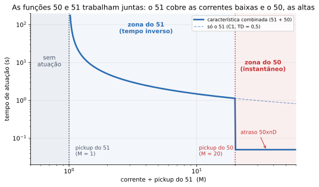
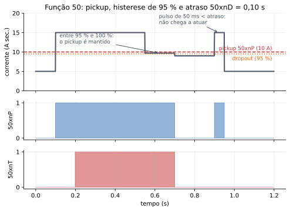
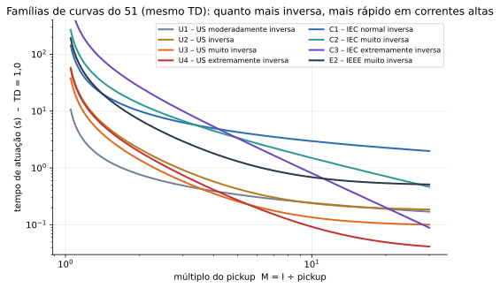
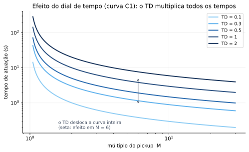
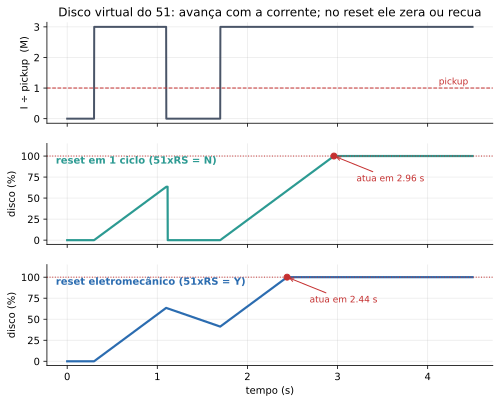
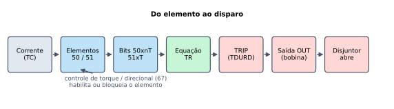
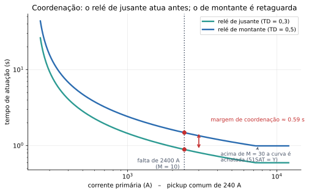

# Funções de sobrecorrente 50 e 51 – guia didático

Este guia explica, do zero, como funcionam as funções **50** (sobrecorrente instantânea / tempo definido) e **51** (sobrecorrente temporizada, de tempo inverso)
do relé SEL-751 e como o **DigitalRelay** as reproduz. Para o controle de sentido (função 67), veja [`funcao-direcional-67.md`](funcao-direcional-67.md).
Detalhes de implementação estão em [`logica-simulada.md`](logica-simulada.md) e em `backend/app/protection.py` / `backend/app/curves.py`.

---

## 1. Por que existe a sobrecorrente?

Quando acontece um curto-circuito, a corrente na linha sobe de forma brusca (de centenas para milhares de ampères). A proteção de sobrecorrente
mede essa corrente e **manda o disjuntor abrir**. Duas ideias complementares:

| Função | Ideia | Característica |
|---|---|---|
| **50** | "Se a corrente passou de um valor, abra **rápido**." | Atua a partir de um valor (*pickup*), com atraso fixo (zero ou poucos ciclos). |
| **51** | "Quanto **maior** a corrente, **mais rápido** abra." | Atua num tempo que depende da corrente, seguindo uma curva de tempo inverso. |

O 50 é a proteção de curto-circuito intenso (perto do relé). O 51 cobre sobrecargas e curtos mais fracos e é a base da **coordenação** com os relés a jusante e a montante.



*Figura 1 – Característica tempo × corrente: abaixo do pickup o relé não atua; entre os pickups do 51 e do 50 vale a curva de tempo inverso; acima do pickup do 50 o tempo cai para o atraso fixo (50xnD).*

---

## 2. Conceitos básicos

- **Pickup (partida):** corrente mínima que "acorda" o elemento. Abaixo dele, o elemento não conta tempo.
- **Valores secundários:** o relé enxerga a corrente depois do TC. Os pickups são ajustados em **A secundários**.
  `I_secundária = I_primária ÷ CTR`. Ex.: com `CTR = 120` (600:5), 1200 A primários = **10 A secundários**.
- **Múltiplo (`M`):** quantas vezes a corrente vale o pickup, `M = I ÷ pickup`. É o eixo horizontal das curvas do 51.
- **Dropout (queda):** o elemento só "solta" quando a corrente cai abaixo de ~95 % do pickup (histerese, evita oscilar sobre o limite).
- **Relay Word:** os resultados aparecem como bits (0/1) usados pelas equações SELogic, por exemplo `TR := 50P1T OR 51P1T`.

### Grandezas medidas

| Grandeza | O que é | Observação |
|---|---|---|
| `IA`, `IB`, `IC` | corrente de cada fase | Usadas pelos elementos `51A/B/C` e `50A1P…`. |
| `IMAX` | maior das três correntes de fase | Elementos de **fase** (`50P`, `51P`). |
| `IN` | corrente de neutro = soma fasorial das fases ÷ `CTRN` | Elementos de **neutro** (`50N`, `51N`). |
| `IG` | corrente residual = soma fasorial ÷ `CTR` (≈ 3I0) | Elementos de **terra/residual** (`50G`, `51G`). |
| `3I2` | corrente de sequência negativa | Elementos de **sequência negativa** (`50Q`, `51Q`); detecta desequilíbrio. |

---

## 3. Função 50 – instantânea / tempo definido

### 3.1 Como funciona

```
corrente  ──▶ [ ≥ pickup (50xnP) e torque ativo? ] ──sim──▶ bit 50xnP = 1
                                                     └─▶ conta o atraso 50xnD ──▶ bit 50xnT = 1
```

- **`50xnP`** (pickup): sobe quando a grandeza medida ≥ pickup (e o controle de torque permite). Cai em 95 % do pickup.
- **`50xnT`** (tempo): sobe depois que `50xnP` permaneceu ligado por `50xnD` segundos. Se `50xnD = 0`, atua no mesmo ciclo ("instantâneo").
- O nome segue o padrão `50` + **tipo** + **nível**: tipo `P` (fase), `N` (neutro), `G` (residual), `Q` (seq. negativa); nível `1` a `4`.
  Exemplos: `50P1P` (fase, nível 1), `50G2T` (residual, nível 2).
- Em `50P1` e `50P2` existem ainda os bits **por fase** `50A1P / 50B1P / 50C1P` (e `…2P`), úteis para saber qual fase picou.
- **`ORED50T`** vale 1 se qualquer `50xnT` estiver ativo.



*Figura 2 – Função 50 no tempo: 50xnP sobe ao ultrapassar o pickup; 50xnT só sobe depois de 50xnD; entre 95 % e 100 % do pickup o estado é mantido (histerese); pulsos mais curtos que o atraso não atuam.*

### 3.2 Ajustes

| Ajuste | Significado | Exemplo |
|---|---|---|
| `50P1P` | pickup (A sec.). **`OFF` desabilita o elemento.** | `10.00` |
| `50P1D` | atraso (s). **`OFF` também desabilita.** | `0.00` |
| `50P1TC` | controle de torque (equação SELogic). `1` = sempre habilitado. | `1` |

### 3.3 Exemplo

`CTR = 120`, `50P1P = 10 A`, `50P1D = 0,00 s` → pickup primário = 10 × 120 = **1200 A**.
Uma falta de 3000 A primários → 25 A secundários → `50P1P` e `50P1T` sobem no mesmo ciclo; o `TR` aciona o `TRIP`, o disjuntor abre em ~60 ms.

### 3.4 Onde se usa (e cuidados)

- **Nível 1** alto e instantâneo para curtos próximos; **níveis 2–4** com pickups menores e atrasos maiores, formando degraus.
- O pickup deve ficar **acima da maior corrente de carga/inrush** e **abaixo da menor corrente de curto** que se quer detectar.
- Um nível alto e instantâneo no alimentador pode atuar para faltas no alimentador seguinte; por isso o ajuste considera o curto no ponto de coordenação.

---

## 4. Função 51 – temporizada (tempo inverso)

### 4.1 Ideia da curva

Em vez de um atraso fixo, o tempo de atuação é dado por uma equação que **diminui conforme `M` cresce**:

```
tempo = TD × ( A / (M^P − 1) + B )          (para M > 1)
```

- `TD` (*time dial*, `51xTD`): multiplica a curva inteira. **Sobe o `TD` → todos os tempos sobem.**
- `A`, `P`, `B` dependem da **família de curvas** escolhida em `51xC`.
- Para `M ≤ 1` o elemento não atua (corrente abaixo do pickup).

### 4.2 Famílias de curvas (ajuste `51xC`)

| Código | Nome | Padrão |
|---|---|---|
| `U1` `U2` `U3` `U4` `U5` | US moderadamente inversa, inversa, muito inversa, extremamente inversa, tempo curto | IEEE/US |
| `C1` `C2` `C3` `C4` `C5` | IEC normal inversa, muito inversa, extremamente inversa, tempo longo, tempo curto | IEC |
| `E1` `E2` `E3` | IEEE C37.112 moderadamente, muito e extremamente inversa | IEEE |




*Figura 3 – Mesmo TD, famílias diferentes: curvas extremamente inversas (U4, C3) caem muito mais depressa em correntes altas; as normais inversas (C1) ficam "mais planas".*
Constantes usadas pelo simulador (`A, P, B`), para a equação acima:

| Curva | A | P | B |
|---|---|---|---|
| U1 | 0,0104 | 0,02 | 0,0226 |
| U2 | 5,95 | 2,0 | 0,180 |
| U3 | 3,88 | 2,0 | 0,0963 |
| U4 | 5,67 | 2,0 | 0,0352 |
| U5 | 0,00342 | 0,02 | 0,00262 |
| C1 | 0,14 | 0,02 | 0 |
| C2 | 13,5 | 1,0 | 0 |
| C3 | 80 | 2,0 | 0 |
| C4 | 120 | 1,0 | 0 |
| C5 | 0,05 | 0,04 | 0 |
| E1 | 0,0515 | 0,02 | 0,1140 |
| E2 | 19,61 | 2,0 | 0,491 |
| E3 | 28,2 | 2,0 | 0,1217 |

### 4.3 Exemplo numérico

`CTR = 120`, `51P1P = 2 A` (pickup primário 240 A), curva `C1`, `TD = 0,5`. Falta de 1800 A primários:

1. `I_sec = 1800 ÷ 120 = 15 A`
2. `M = 15 ÷ 2 = 7,5`
3. `tempo = 0,5 × 0,14 / (7,5^0,02 − 1) = 0,5 × 0,14 / 0,0411 ≈ 1,70 s`

Tempos da curva `C1` (em segundos) para alguns múltiplos:

| `M` | 1,5 | 2 | 3 | 5 | 10 | 20 |
|---|---|---|---|---|---|---|
| `TD = 1,0` | 17,19 | 10,03 | 6,30 | 4,28 | 2,97 | 2,27 |
| `TD = 0,5` | 8,60 | 5,02 | 3,15 | 2,14 | 1,49 | 1,13 |

Compare com `U3` (muito inversa), `TD = 1,0`: 3,20 · 1,39 · 0,58 · 0,26 · 0,135 · 0,106 s para os mesmos múltiplos — a curva "cai" bem mais depressa.



*Figura 4 – O TD multiplica o tempo em todos os pontos: dobrar o TD dobra todos os tempos da curva.*

### 4.4 Ajustes adicionais

| Ajuste | Função |
|---|---|
| `51xP` | pickup (A sec.); `OFF` desabilita. |
| `51xC` | curva (U1…U5, C1…C5, E1…E3). |
| `51xTD` | *time dial*. |
| `51xCT` | **tempo constante somado** ao tempo da curva (s). |
| `51xMR` | **resposta mínima**: o tempo nunca fica abaixo desse valor. O cálculo é `t = máx(tcurva, MR) + CT`. |
| `51xRS` | tipo de **reset**: `N` = rearma em 1 ciclo; `Y` = **eletromecânico** (o "disco" recua devagar). |
| `51xTC` | controle de torque (equação SELogic). |
| `51SAT` (global) | `Y`: o múltiplo é limitado a **30** (a curva "achata" nas correntes muito altas). |

### 4.5 Como o relé "conta" o tempo (o disco virtual)

O 51 imita um relé eletromecânico de disco. A cada ciclo de varredura o simulador avança uma fração do percurso:

```
progresso += dt / t_total(M)         → quando progresso ≥ 1  ⇒  51xT = 1 (atuou)
```

Isso trata corretamente correntes que **variam durante a contagem**: se a corrente aumenta, o disco acelera; se cai abaixo do pickup, o avanço para.



*Figura 5 – A mesma corrente (M = 3, duas vezes): com reset em 1 ciclo o disco volta a zero e o 51 atua em 2,96 s; com reset eletromecânico o disco recua só um pouco e o 51 atua mais cedo (2,44 s).*

### 4.6 Reset

- **`51xRS = N`**: se a corrente cai abaixo do pickup, o progresso zera **depois de 1 ciclo** da frequência nominal.
- **`51xRS = Y` (eletromecânico):** o disco volta com o tempo `tr = TD × R / (1 − M²)` (em `C4`, `1 − M`), usando o múltiplo atual (`M < 1`). Se a corrente voltar antes do rearme completo, **a contagem parcial é aproveitada** — importante para faltas intermitentes.
- O bit **`51xR`** indica "totalmente rearmado": sem pickup e disco em zero.
  Ex.: `C1`, `TD = 1`, `M = 0` → 13,5 s para rearmar; com `M = 0,5` → 18 s.

### 4.7 Bits do 51

| Bit | Significado |
|---|---|
| `51xP` | em pickup (`M ≥ 1`). |
| `51xT` | tempo esgotado (disco chegou ao fim): **atuação**. |
| `51xR` | rearmado. |
| `ORED51T` | qualquer 51 atuado. |

Os elementos são: `51A/B/C` (por fase), `51P1/51P2` (fase máxima), `51Q` (seq. negativa), `51N1/51N2` (neutro) e `51G1/51G2` (residual).

---

## 5. Controle de torque (`50xnTC` / `51xTC`)

É uma equação SELogic que **habilita ou bloqueia** o elemento. Se for falsa, o elemento fica desabilitado e reiniciado (pickup cai, disco zera).
Usos clássicos: bloquear o 50 durante a energização (*cold load*), travar por lógica de bloqueio entre relés, ou exigir que o disjuntor esteja fechado.

Com a **função direcional (67)** ativa, o sentido da falta também entra nesse "interruptor": se o nível estiver bloqueado para o sentido atual, o elemento é desabilitado exatamente como por torque. Veja [`funcao-direcional-67.md`](funcao-direcional-67.md).

---

## 6. Do elemento ao disparo

```
medida ─▶ 50/51 ─▶ bit 50xnT / 51xT ─▶ equação TR ─▶ TRIP ─▶ saída (bobina) ─▶ disjuntor abre
```

- A equação **`TR`** (SELogic) reúne os bits de atuação, por exemplo `TR := 50P1T OR 51P1T OR 50G1T`.
- O `TRIP` mantém-se ligado por `TDURD` e só cai quando `ULTRIP` é verdadeiro e `TR` é falso.
- O disjuntor abre após o tempo mecânico (padrão do simulador: 60 ms); com a corrente ainda presente, a supervisão de **tempo de abertura** pode alarmar (100/120/140 ms no ajuste "Alimentador v1.24").
- Depois do trip, o **religamento (79)** pode tentar fechar de novo.



*Figura 6 – Do elemento de sobrecorrente à abertura do disjuntor.*

---

## 7. Coordenação em poucas palavras

Dois relés em série (um perto da carga, outro mais a montante) precisam atuar **na ordem certa**: o de jusante primeiro. Para isso:

1. Use a **mesma família de curvas** nos dois.
2. O relé de montante recebe `TD` maior (ou pickup maior), deixando uma **margem de coordenação** (tipicamente 0,2–0,4 s) para a mesma corrente.
3. Confira vários múltiplos, não só um.

Exemplo com `C1`: para `M = 5`, `TD = 0,3` dá 1,28 s e `TD = 0,5` dá 2,14 s — o relé com `TD = 0,5` só atua se o de `TD = 0,3` falhar (≈ 0,86 s de margem).



*Figura 7 – Curvas C1 com mesmo pickup (240 A): para 2400 A o relé de jusante (TD = 0,3) atua em 0,89 s e o de montante (TD = 0,5), em 1,49 s – margem de ≈ 0,6 s. Acima de M = 30 as curvas ficam achatadas (51SAT = Y).*

---

## 8. Experimente no DigitalRelay

1. Carregue um ajuste e, na aba **Ajustes** (classe do grupo ativo, p.ex. `1`), defina `50P1P = 10` e `51P1P = 2`.
2. No painel inicial, ligue a **Injeção analógica** e abra a **janela de injeção**. Informe, por exemplo, 3000 A primários nas fases (use o modo Primário).
3. Em **Variáveis internas → Elementos de proteção** veja: múltiplo, **tempo previsto**, avanço do disco e os bits de partida/atuação/reset.
4. Reduza a corrente para 0,9 × pickup e observe o reset (1 ciclo ou eletromecânico, conforme `51xRS`).
5. Altere `51P1C` (curva) e `51P1TD` e compare os tempos previstos com as tabelas deste guia.
6. Defina `50P1D` como `OFF` e veja o elemento ser desabilitado.

## 9. Resumo

| | 50 | 51 |
|---|---|---|
| Tempo de atuação | fixo (`50xnD`) | depende da corrente (curva) |
| Principal uso | curtos intensos e próximos | sobrecarga e coordenação |
| Ajustes principais | pickup, atraso, torque | pickup, curva, TD, CT, MR, reset |
| Bits | `50xnP`, `50xnT` | `51xP`, `51xT`, `51xR` |
| Dropout | 95 % do pickup | 95 % do pickup; reset 1 ciclo ou EM |

---

*As figuras estão em `docs/img/` e são geradas por `python docs/img/gerar_figuras.py` (requer matplotlib; as curvas e a simulação usam o próprio código do simulador).*
